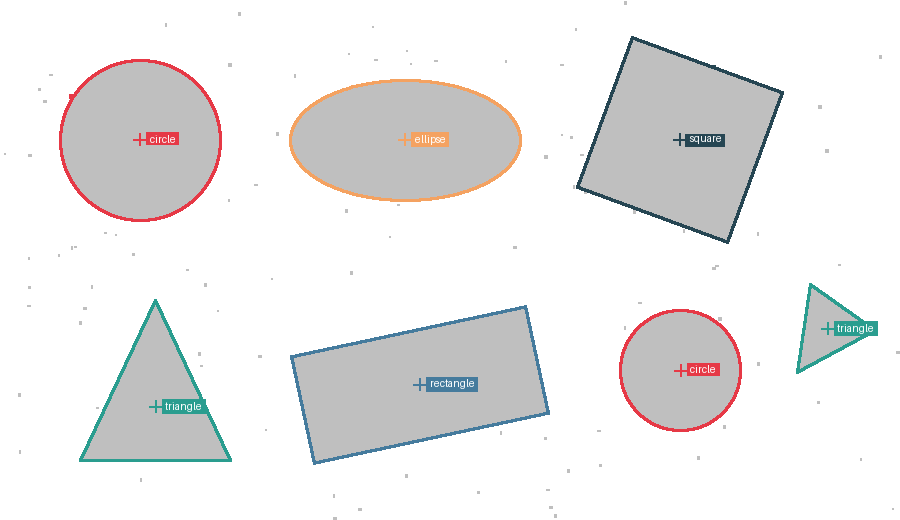

# Contagion

Shape detection by recursive pixel spreading. No OpenCV, no learned model:
just a binary image, a recursive "infection" that collects each shape pixel by
pixel, and a bit of statistics around each shape's barycentre.



```
square    at ( 680,  139)   25728 px  corners=4  cv=0.110
circle    at ( 140,  140)   20330 px  corners=0  cv=0.004
ellipse   at ( 405,  140)   21948 px  corners=2  cv=0.225
triangle  at ( 827,  329)    3247 px  corners=3  cv=0.233
triangle  at ( 155,  407)   12231 px  corners=3  cv=0.236
rectangle at ( 420,  384)   26346 px  corners=4  cv=0.278
circle    at ( 680,  370)   11497 px  corners=0  cv=0.004
```

The 120 specks of dust on the [input](examples/input.png) are gone: the sieve
dropped them.

## How it works

1. **Infinite contrast.** The image is pushed until every pixel is 0 or 1
   (Otsu's method picks the threshold unless you give one).
2. **Scan.** A loop walks the rows, pixel by pixel, until it lands on a 1.
3. **Contagion.** That pixel is recorded and set to 0, then a recursive
   function looks at every pixel within a radius *r*: each 1 it finds is
   recorded, set to 0, and spreads the infection from there. The recursion ends
   when everything around is 0. The whole shape is now one cluster, and it is
   gone from the image.
4. **Repeat.** The scan resumes where it stopped, until the image is all zeros.
5. **Sieve.** Clusters smaller than *X* pixels are discarded as noise.
6. **Classification from the barycentre.** For each cluster, take the distance
   from the barycentre to every contour pixel:
   - its **coefficient of variation** (standard deviation / mean) is near zero
     only for a circle;
   - plotted against the angle, that distance rises to **one peak per corner**:
     2 for an ellipse, 3 for a triangle, 4 for a quadrilateral, and comparing
     the dips between the 4 peaks tells a square from a rectangle.

   Because it is measured around the barycentre, none of this depends on how
   the shape is rotated. Holes are filled first, so a ring or a round button
   with an icon on it still reads as a circle, and a shape whose area falls
   well short of its convex hull (a letter, two shapes merged) is left as
   `unknown` rather than forced into a category.
7. **Overlay.** Each barycentre gets its label and its contour, drawn over the
   original image.

The radius *r* matters: `r = 1` spreads to the 8 touching pixels; a larger
radius jumps small gaps, so a dashed or slightly broken outline stays one shape.

## Run it

```bash
pip install -r requirements.txt
python demo.py                                  # draws the test sheet, writes examples/
python contagion.py photo.png -o out.png --radius 2 --min-pixels 100
pytest -q                                       # 21 tests
```

## Compared with OpenCV

Short answer: OpenCV is faster, and it should be. Measured on a 12-megapixel
phone photo (best of several runs, Apple Silicon):

| | Contagion, pure Python | Contagion, compiled ([PR #1](https://github.com/dapavo16/contagion/pull/1)) | OpenCV |
|---|---|---|---|
| Grouping the pixels | 2.3 s | 22 ms | — |
| Whole pipeline | 7.4 s | 123 ms | 8.7 ms |

**Why OpenCV wins.** Its connected-components and contour code is over twenty
years of tuned C++: it scans the image in 2×2 blocks with SIMD instructions and
precomputed decision tables, reading memory once or twice in straight lines,
which suits the CPU cache. The contagion is a flood fill: it jumps from a pixel
to its neighbours in every direction, a well-known and sound approach, but on a
modern CPU line-scanning labellers are faster.

**Why the comparison is not like for like.**

- OpenCV's pipeline here (threshold, external contours, polygon approximation)
  finds outlines; it does not say "circle" or "square". The contagion does the
  whole classification, and that is where most of its time goes. A fair
  head-to-head would build the same classifier on top of OpenCV.
- The contagion radius has no direct OpenCV equivalent: with `r > 1` a dashed
  or broken outline stays one shape. OpenCV needs an extra morphology step (a
  dilation) to do the same.
- Not measured yet: dedicated shape detectors such as the Hough transform for
  circles, which are typically much slower than plain contour finding.

**Closing the gap.** Compiling the classification as well should bring the
whole pipeline to around 30 ms for 12 megapixels, about three times OpenCV.
Beyond that, a block-based scan instead of a flood fill would change the
algorithm itself, which is not the point of this project.

## Notes

- The contagion recurses once per pixel, so a large shape goes tens of
  thousands of calls deep. It runs in a worker thread with a large stack and a
  raised recursion limit; an explicit stack would do the same job iteratively,
  but the recursive version is the idea as I first wrote it.
- Speed: each pixel is visited once, so the work grows linearly with the
  image. In pure Python that still means about 0.3 s for the demo sheet and
  7 s for a 12-megapixel photo; a compiled version is in
  [PR #1](https://github.com/dapavo16/contagion/pull/1).
- A 12-megapixel photo has shapes of over a million pixels, deeper than the
  recursion can go: `find_clusters(..., recursive=False)` runs the same
  contagion on an explicit stack, with no depth limit.
- On a real phone photo (900×675, reflections, uneven light), Otsu's threshold
  holds up: round buttons come out as circles,
  rounded icons as squares, toggles as ellipses, text as `unknown`.
- Limits: shapes that touch become one cluster (a phone and its charging
  cable), and anything that is not a basic shape (a gear icon) stays `unknown`.

## Origin

I came up with this algorithm in 2022. This repository is a 2026
re-implementation of that design, written with Claude Code.

## License

MIT, see [LICENSE](LICENSE).
